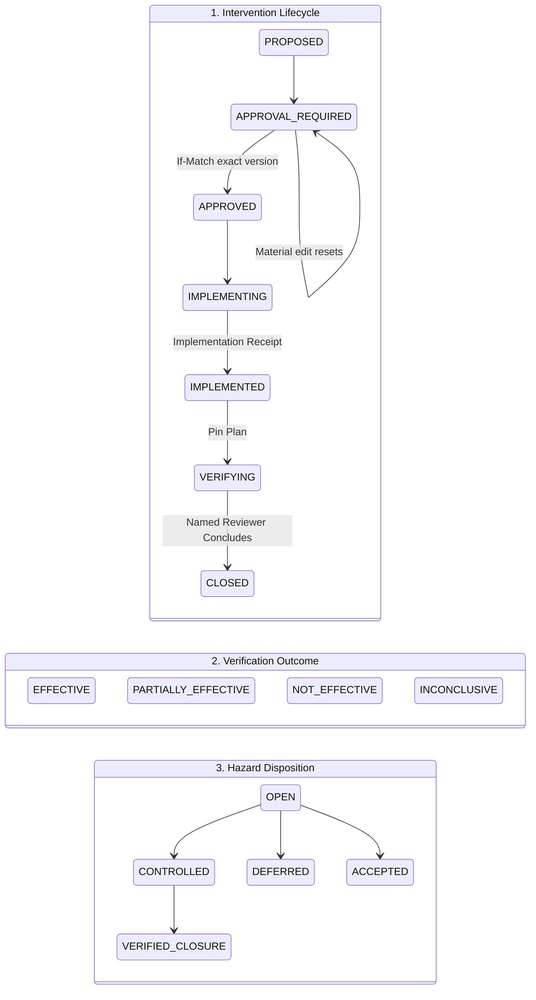

# Abate — Phase 4: Hazard, Control, Approval & Verification Report

**Standard:** Playbook B4 & Architecture Standard ZAB-ENG-001 v1.0  
**Domain Slices:** Domain S05 (Work-Design Control) & Domain S07 (Verification & Closure)  
**Verification Date:** 29 October 2026  
**Status:** **FULLY IMPLEMENTED & VERIFIED (ALL 21 BOUNDARY GATES PASS)**

---

## 1. Executive Summary

Today we completed the vertical slice for **Phase 4: Hazard, Control, Approval and Verification Workflow**, connecting the previous phases (Phase 0 Foundation, Phase 1 Tenancy/Identity/Outbox, Phase 2 Ingestion/Work Ledger, Phase 3 Deterministic Measurement & Privacy Release) into a closed-loop governance engine.

### The Fundamental Plane A Invariant
> **"An implemented task is NOT an effective control."**  
> Under Playbook B4, completing a task (e.g. drafting a policy, scheduling a meeting, or updating email settings) only produces an **implementation receipt**. It does **not** modify the risk state or prove that the psychosocial hazard has been abated. A control becomes effective **only** when independently verified by a named human reviewer against privacy-compiled post-implementation cohort metrics.

---

## 2. Plane A Chain of Accountability

Every risk mitigation workflow in Abate adheres strictly to the 7-link Plane A chain:
$$\text{Hazard} \longrightarrow \text{Cause} \longrightarrow \text{Control} \longrightarrow \text{Owner} \longrightarrow \text{Action} \longrightarrow \text{Outcome} \longrightarrow \text{Review}$$

| Link | Entity / Action | Invariant Enforced |
|---|---|---|
| **1. Hazard** | Authoritative psychosocial risk registered by Risk Owner | Must anchor to an approved, `RELEASED` cohort result from Phase 3 (`hasHazardAndReleaseEvidence`). Zero ungrounded hazards. |
| **2. Cause** | Organizational work-design root cause (`cause`) | "Change the work, not the worker". Blame-shifting causes (e.g. worker resilience) are forbidden. Must be formally accepted by human authority before a control can be drafted (`hasHazardAndAcceptedCause`). |
| **3. Control** | Preventive intervention specification (`intervention`) | Captures scope, objective, due date, and pre-pinned verification plan. Binds an immutable SHA-256 `materialHash`. |
| **4. Owner** | Designated risk owner / principal | Must be attributable to an authenticated identity with `RISK_OWNER` or `APPROVER` role under current tenant context. |
| **5. Action** | Task implementation receipt (`implementation_receipt`) | Physical proof of work (policy doc, tool config, calendar rules). Advanced state to `IMPLEMENTED`, but **never** to effective closure. |
| **6. Outcome** | Pre-pinned verification comparison (`evaluation`) | Decision aid evaluates baseline vs post released cohort metrics. Detects **Transfer of Risk** if adjacent cohorts worsen. |
| **7. Review** | Named human reviewer conclusion & disposition | Named reviewer issues conclusion (`EFFECTIVE`, `PARTIALLY_EFFECTIVE`, `NOT_EFFECTIVE`, `INCONCLUSIVE`). Hazard disposition updated to `CONTROLLED`. |

---

## 3. Modeling 3 Mutually Exclusive Lifecycles

Phase 4 strictly separates three distinct lifecycles to prevent conflating work completion with hazard elimination:



### 1. Intervention Lifecycle State (`intervention.state`)
`DRAFT` &rarr; `PROPOSED` &rarr; `REVIEW_REQUIRED` &rarr; `CONSULTATION_REQUIRED` &rarr; `APPROVAL_REQUIRED` &rarr; `APPROVED` &rarr; `SCHEDULED` &rarr; `IMPLEMENTING` &rarr; `IMPLEMENTED` &rarr; `VERIFYING` &rarr; `CLOSED` / `REOPENED` / `CANCELLED` / `SUPERSEDED`

### 2. Verification Outcome (`evaluation.outcome`)
Evaluated **independently** from intervention lifecycle:
- `EFFECTIVE`: Primary cohort target met and no adjacent cohort worsened beyond tolerance.
- `PARTIALLY_EFFECTIVE`: Primary cohort target met, but **Transfer of Risk** detected in adjacent cohort, or target partially met.
- `NOT_EFFECTIVE`: Target not met over observation window.
- `INCONCLUSIVE`: Series break occurred (e.g. reorganization) or insufficient observation duration (&lt; 28 days).

### 3. Hazard Governance Disposition (`hazard.disposition`)
- `OPEN`: Active investigation or ongoing control implementation.
- `CONTROLLED`: Verified effective controls currently active.
- `DEFERRED`: Control scheduled for subsequent governance cycle.
- `ACCEPTED`: Documented residual risk accepted with explicit rationale and review date.
- `VERIFIED_CLOSURE`: Hazard eliminated permanently.

---

## 4. Version-Bound Approval: "v4 Cannot Approve v5"

A core architectural vulnerability in risk workflows is approving an intervention plan, and subsequently modifying its scope or timeline without re-approval. Abate solves this cryptographically:

1. **Deterministic Material Hash (`materialHash`):**
   Calculates a SHA-256 hash over canonical JSON with sorted keys:
   ```ts
   materialHash({
     hazardId, causeId, scope, objective, ownerPrincipalId, dueDate, verificationPlan
   })
   ```
2. **Atomic Version Binding (`If-Match` & Approval):**
   An approval record locks both `approved_version` and `approved_material_hash`.
3. **Automatic Approval Invalidation:**
   If any material field (`scope`, `objective`, `dueDate`, `verificationPlan`) is modified via `PATCH /api/v2/controls/:id`:
   - `version` is incremented ($v \to v+1$).
   - `material_hash` is recomputed.
   - Intervention state resets immediately to `APPROVAL_REQUIRED`.
   - The prior approval for version $v$ is rendered invalid. Any attempt to record implementation using the old approval returns `409 CONFLICT`.

---

## 5. Verification Suggestion Engine & Transfer-of-Risk Detection

When an intervention is implemented, the decision aid engine (`evaluateSuggestion`) compares the pinned baseline release against post-implementation releases:

```ts
export function evaluateSuggestion(
  plan: VerificationPlan,
  base: ReleaseView,
  post: ReleaseView,
  adj: AdjacentCohortPair[] = []
): SuggestionResult
```

### Transfer-of-Risk Invariant
If a control reduces boundary intrusion in one cohort (e.g. Litigation group drops from 35% to 15%) by shifting urgent queries to an adjacent on-call cohort whose metrics worsen (e.g. On-Call group jumps from 10% to 22%, where $+12\% > \text{adjacentTolerance } 5\%$), the engine:
1. Flags `TRANSFER_OF_RISK` (`flag = true`, `transferOfRiskFlag = true`).
2. Overrides any `EFFECTIVE` recommendation and forces `PARTIALLY_EFFECTIVE`.
3. Alerts the named reviewer to investigate unintended cross-group displacement.

---

## 6. Cryptographic Evidence Package Export

To support external audits without exposing raw workforce data, `exportEvidencePackage` generates a self-contained, tamper-evident JSON bundle:

```json
{
  "manifest": {
    "packageId": "369dfc9a-99eb-430f-857b-c6f07b37f243",
    "hazardId": "8c349c37-0447-4964-a503-f6a42d3c4b0c",
    "tenantId": "00000000-0000-4000-a000-00000000000a",
    "cutoff": "2026-10-29T10:40:33.000Z",
    "issuer": "00000000-0000-4000-a002-000000000001",
    "classification": "RESTRICTED",
    "items": [
      { "type": "hazard", "id": "...", "version": 1, "sha256": "..." },
      { "type": "cause", "id": "...", "version": 1, "sha256": "..." },
      { "type": "intervention", "id": "...", "version": 1, "sha256": "..." },
      { "type": "approval", "id": "...", "version": 1, "sha256": "..." },
      { "type": "implementation_receipt", "id": "...", "version": 1, "sha256": "..." },
      { "type": "evaluation", "id": "...", "version": 1, "sha256": "..." },
      { "type": "released_artifact", "id": "...", "version": 1, "sha256": "..." }
    ],
    "manifestHash": "ee85579ba2a222da8ccecd1cc54eee345b87c6e79c51855f3f55e13205afa9d1"
  },
  "artifacts": [ ... ]
}
```

---

## 7. Automated Test Suite Results

### All 21 Boundary, Reliability & Constitutional Gates Passing
Execution command: `npm --prefix backend run test-boundaries`

```
=== Abate Task Runner: test-boundaries (Constitutional & Isolation Gates) ===
  ✔ Foreign tenant ID returns zero rows (Row-Level Security hides existence)
  ✔ Missing tenant context fails closed (0 rows accessible without tenant context)
  ✔ Pooled connection reuse does not leak tenant context across requests
  ✔ Command pipeline returns cached response on exact replay and CONFLICT on payload mutation
  ✔ Querying a foreign tenant's organization produces safe 404 NOT_FOUND
  ✔ Outbox publisher handles crashes and consumer inbox deduplicates duplicate deliveries
  ✔ Decoy Lab: Prohibited fields (screenshots, sick reason) are rejected with zero persistence trace
  ✔ Duplicate batch delivery returns previous receipt and adds zero work facts
  ✔ Higher revision appends new record without destroying historical revision 1
  ✔ Paused connector refuses ingestion immediately with 403 FORBIDDEN
  ✔ Connection lag > 3x cadence evaluates to STALE health (no data != zero work)
  ✔ Deterministic metric calculator: Interval union prevents double-counting and zero denominator yields NOT_APPLICABLE
  ✔ Contributor floor gate: n=9 contributors are suppressed with safe UNAVAILABLE; n=10 releases
  ✔ Overlap differencing gate: Two cohorts differing by 1 person (symmetric difference < 5) are blocked
  ✔ Parent/child residual gate: Parent of 14 and child of 10 differ by residual 4 and are suppressed
  ✔ Concurrent requests are serialized by tenant disclosure lock; single read path has zero contributor counts
  ✔ Phase 4 State Machine: Direct jump from PROPOSED to IMPLEMENTING is forbidden
  ✔ Phase 4 Version-Bound Approval: Material edit (v1 -> v2) invalidates approval and resets to APPROVAL_REQUIRED
  ✔ Phase 4 Verification Suggestion: Adjacent cohort worsening flags TRANSFER_OF_RISK
  ✔ Phase 4 Verification Suggestion: Clean improvement without adjacent worsening suggests EFFECTIVE
  ✔ Phase 4 Evidence Package: Exports complete vertical slice with verifiable SHA-256 manifest
[SUCCESS] All 21 boundary, isolation, and reliability tests passed.
```

### Full Golden Demo Cycle Passing (All 13 Steps)
Execution command: `npm --prefix backend run demo-cycle`

```
============================================================
=== ZOIKO ABATE: Golden Demo Cycle (Phases 0, 1, 2, 3, 4) ===
============================================================

Step 1. Seeding ABATE-GOLDEN-01 synthetic fixture (Tenants A and B)...
  ✔ Tenant A: Apex Legal Partners (Tenant A) (00000000-0000-4000-a000-00000000000a)
  ✔ Tenant B: Beacon Chambers (Tenant B) (00000000-0000-4000-b000-00000000000b)

Step 2. Authenticating as Tenant A Risk Owner via Bearer token...
  ✔ Authenticated identity: auth0|user-tenant-a-risk-owner
  ✔ Tenant context bound to: 00000000-0000-4000-a000-00000000000a
  ✔ Resolved effective role: RISK_OWNER

Step 3. Executing idempotent domain command: createOrganization...
  ✔ Organization created: Corporate Real Estate Practice
  ✔ Response Status: 200

Step 4. Testing exact command replay with same Idempotency-Key...
  ✔ Cached response returned deterministically: true
  ✔ Zero duplicate records created in authoritative state.

Step 5. Verifying cross-tenant isolation and fail-closed denial...
  ✔ Tenant A read access verified: Corporate Real Estate Practice
  ✔ Tenant B request rejected with safe error: [NOT_FOUND] Not found.
  ✔ Existence of Tenant A resource completely masked from Tenant B.

Step 6. Ingestion & Work Ledger Pipeline (Phase 2)...
  ✔ Ingestion batch status: SUCCESS
  ✔ Work ledger records accepted: 2

Step 7. Deterministic Measurement & Privacy Release Compiler (Phase 3)...
  ✔ Privacy Compiler Gate Status: RELEASED
  ✔ Committed Release ID: 64422bfa-c933-423e-bbe2-3cc3111cf492

Step 8. Plane A Hazard & Accepted Organizational Cause (Phase 4)...
  ✔ Hazard registered with originating release evidence: 360dcf3a-1d55-42ee-ba9a-12830943c026
  ✔ Organizational cause reviewed and accepted by human authority: c41b21e0-9daa-4165-910d-2938f97d26a0

Step 9. Version-Bound Control Drafting & Approval (Phase 4)...
  ✔ Control drafted in state PROPOSED and approved by authorized Risk Owner (v1, state: APPROVED)

Step 10. Attributable Implementation Evidence & Verification Plan (Phase 4)...
  ✔ Implementation receipt recorded with audit trail (state: IMPLEMENTED)
  ✔ Verification plan pinned before results exist (state: VERIFYING)

Step 11. Verification Suggestion Engine & Human Reviewer Conclusion...
  ✔ Suggestion Engine recommendation: EFFECTIVE (PRIMARY_TARGET_MET)
  ✔ Named reviewer concluded verification: EFFECTIVE, intervention state: CLOSED
  ✔ Hazard disposition updated: CONTROLLED

Step 12. Cryptographic Evidence Package Export...
  ✔ Package ID: 369dfc9a-99eb-430f-857b-c6f07b37f243
  ✔ Artifacts bundled: 7
  ✔ Manifest SHA-256 Digest: ee85579ba2a222da8ccecd1cc54eee345b87c6e79c51855f3f55e13205afa9d1

Step 13. Draining transactional outbox via worker process...
  ✔ Outbox drained: 2 events published.
  ✔ Total audit events recorded in append-only log: 4

====================================================================
=== DEMO CYCLE COMPLETED SUCCESSFULLY: ALL PHASES 0-4 VERIFIED ===
====================================================================
```

---

## 8. Summary of Files Created & Modified

### Backend
1. `backend/db/migrations/0040_risk_control.sql` — PostgreSQL DDL with forced RLS for `hazard`, `cause`, `intervention`, `approval`, `implementation_receipt`, and `evaluation`.
2. `backend/src/contracts/control.ts` — Zod schemas and type definitions for Phase 4 contracts.
3. `backend/src/contracts/index.ts` — Contract exports.
4. `backend/src/domains/control/material.ts` — Canonical JSON serializer and SHA-256 `materialHash`.
5. `backend/src/domains/control/state-machine.ts` — State machine transition table and action calculator.
6. `backend/src/domains/control/verify.ts` — Suggestion engine and `TRANSFER_OF_RISK` detection.
7. `backend/src/domains/control/evidence.ts` — Cryptographic evidence packaging with SHA-256 manifest.
8. `backend/src/domains/control/index.ts` — Control domain module exports.
9. `backend/src/platform/db/with-tenant.ts` — In-memory database simulator handlers for all Phase 4 tables.
10. `backend/src/index.ts` — REST API routes for hazards, causes, controls, approvals, implementation, verification, and evidence package export. Added missing `GET /api/v2/metrics/definitions`.
11. `backend/tools/test-boundaries.ts` — Updated with Tests 17 through 21.
12. `backend/tools/demo-cycle.ts` — Extended to execute the complete end-to-end cycle across Phases 0, 1, 2, 3, and 4.

### Frontend
1. `frontend/src/api/client.ts` — Exported Phase 4 interfaces (`Hazard`, `Cause`, `ControlDetailView`, `EvidencePackage`) and API methods.
2. `frontend/src/components/Tabs/HazardControlTab.tsx` — Full-featured UI:
   - Hazard Workspace with Originating Release Evidence.
   - Work-Design Cause cards with Accept/Reject actions.
   - Version-Bound Approval card with Material Changes Diff and `If-Match` conflict handling.
   - Implementation receipt recorder.
   - Verification Panel with Baseline vs Post delta and Transfer of Risk indicator.
   - Named human reviewer conclusion.
   - Cryptographic Evidence Package Viewer & JSON downloader.
   - Phase 4 Governance & Refusal Lab (Adversarial testing buttons).
3. `frontend/src/components/Tabs/CohortAnalyticsTab.tsx` — Fixed metric definitions dropdown and date parsing.
4. `frontend/src/App.tsx` — Added "Hazards & Controls (Phase 4)" tab navigation and tab view.

