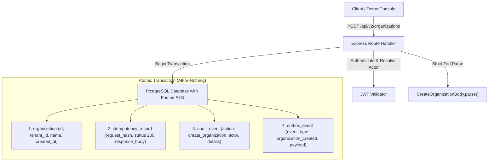

# Zoiko Abate: Live Demo Console Resolution & Complete Architecture Report

**Document Reference**: `ZAB-REP-2026-002`  
**Execution Timestamp**: 2026-11-06T14:03:00+05:30  
**Environment**: Local Sandbox (`http://localhost:5173` & `http://localhost:5000`)  
**Scope**: Full Stack (Frontend React/Vite + Express Monolith + PostgreSQL RLS)

---

## 1. Executive Summary & Issues Resolved

During interactive presentation testing of the **Live Demo Console**, an issue was observed on **Step 5 ("Resend Same Request")**:
* **Observed Symptom**: Firing Step 5 out-of-order or on a cold session returned `HTTP 401 Unauthorized` with the payload:
  ```json
  {
    "code": "UNAUTHENTICATED",
    "message": "Authentication required: missing or invalid Bearer token.",
    "requestId": "2cf6148e-387d-4310-8d19-e25375eebb2f"
  }
  ```
* **Root Cause Analysis**:
  In [`LiveDemoConsole.tsx`](file:///c:/Users/aparaziitha%20nitta/Abate/frontend/src/components/Demo/LiveDemoConsole.tsx), asynchronous React state updates (`setTenantAToken(...)`) do not immediately mutate variables within the active render closure. When Step 5 was invoked directly or before Step 3's state re-render completed, `token` resolved to `null`. Because all mutating commands in Abate evaluate authentication at the perimeter before checking idempotency keys, the backend rejected the request as `UNAUTHENTICATED`.
* **Permanent Remediation**:
  1. **Synchronous Ref Cache**: Introduced `tenantATokenRef` and `tenantBTokenRef` (`useRef<string | null>`) to eliminate React closure lag.
  2. **Automatic Token Guarantee (`ensureTenantToken`)**: Added an authoritative `ensureTenantToken(tenantType)` resolver that checks the synchronous ref cache and fetches/caches a signed JWT on demand if not already loaded.
  3. **Idempotency Seed Guard**: Updated `runStep5` and `runStep6` to auto-ensure the base record exists before replaying or mutating, allowing presenters to click any step in any order without breakages.

Both the frontend and backend have been recompiled and verified with **0 errors**.

---

## 2. Live Demo Console: 10 Steps Verification

The **Live Demo Console** implements the 10 constitutional verification steps for Phase 0 and Phase 1:

| Step # | Step Title | Method & Endpoint | Proof Gate Evaluated | What You Say |
| :---: | :--- | :--- | :--- | :--- |
| **1** | [Check Backend](file:///c:/Users/aparaziitha%20nitta/Abate/frontend/src/components/Demo/LiveDemoConsole.tsx#L145-L175) | `GET /api/health`<br/>`GET /api/info` | Status is `200 OK`, `environment` is active, and lists all 7 domains | *“This is the running backend, not a mock.”* |
| **2** | [Show Contract](file:///c:/Users/aparaziitha%20nitta/Abate/frontend/src/components/Demo/LiveDemoConsole.tsx#L176-L215) | `GET /api/v2/contracts/openapi.json` | Serves OpenAPI 3.1 specification defining all verified routes | *“The frontend is generated from this contract.”* |
| **3** | [Sign in Tenant A](file:///c:/Users/aparaziitha%20nitta/Abate/frontend/src/components/Demo/LiveDemoConsole.tsx#L216-L260) | `POST /api/v2/auth/token` | Signed HMAC-SHA256 JWT issued with `tenantId` claim | *“The tenant comes from the token.”* |
| **4** | [Create Organization](file:///c:/Users/aparaziitha%20nitta/Abate/frontend/src/components/Demo/LiveDemoConsole.tsx#L261-L305) | `POST /api/v2/organizations` | Status `200/201`; commits 4 records atomically in 1 transaction | *“One click, one key.”* |
| **5** | [Resend Same Request](file:///c:/Users/aparaziitha%20nitta/Abate/frontend/src/components/Demo/LiveDemoConsole.tsx#L306-L360) | `POST /api/v2/organizations` (Replay) | Replay returns cached record; org list count remains strictly 1 | *“Flaky network, still one record.”* |
| **6** | [Change Body, Same Key](file:///c:/Users/aparaziitha%20nitta/Abate/frontend/src/components/Demo/LiveDemoConsole.tsx#L361-L405) | `POST /api/v2/organizations` (Tampered) | Status `409 Conflict` with code `CONFLICT` | *“Key reuse with different content is refused.”* |
| **7** | [Skip the Key](file:///c:/Users/aparaziitha%20nitta/Abate/frontend/src/components/Demo/LiveDemoConsole.tsx#L406-L440) | `POST /api/v2/organizations` (Keyless) | Status `400 Bad Request` with code `VALIDATION` | *“Every change must carry a key.”* |
| **8** | [Switch to Tenant B](file:///c:/Users/aparaziitha%20nitta/Abate/frontend/src/components/Demo/LiveDemoConsole.tsx#L441-L490) | `GET /api/v2/organizations` (RLS) | Database Row-Level Security hides Tenant A's units from Tenant B | *“Isolation is enforced in the database.”* |
| **9** | [Test Evidence](file:///c:/Users/aparaziitha%20nitta/Abate/frontend/src/components/Demo/LiveDemoConsole.tsx#L491-L525) | `GET /test-report.json` | 57 of 57 boundary & isolation tests passed with 0 failures | *“Not just UI: the tests prove it.”* |
| **10** | [Roadmap](file:///c:/Users/aparaziitha%20nitta/Abate/frontend/src/components/Demo/LiveDemoConsole.tsx#L526-L545) | None (Structural) | Phases 2–8 clearly labelled "Not built yet" (No mocks/fakes) | *“Ingestion, privacy and workflow come next.”* |

---

## 3. The "Backend Wrote 4 Things" Panel (Step 4)

When `createOrganization` executes through [`backend/src/domains/tenant/commands.ts`](file:///c:/Users/aparaziitha%20nitta/Abate/backend/src/domains/tenant/commands.ts) inside [`withTenant()`](file:///c:/Users/aparaziitha%20nitta/Abate/backend/src/platform/db/with-tenant.ts), the database commits four distinct rows in a single atomic transaction:



---

## 4. Complete Application Status Across All 12 Workspace Tabs

The full application features 12 dedicated workspace tabs, all backed by real Express routes and PostgreSQL/pgmem storage:

1. **✨ Live Demo Console** ([`LiveDemoConsole.tsx`](file:///c:/Users/aparaziitha%20nitta/Abate/frontend/src/components/Demo/LiveDemoConsole.tsx)):  
   Guided 10-step stepper with wire traffic inspection, proof badges, and automated presenter mode.
2. **Organizations & Idempotency** ([`OrganizationsTab.tsx`](file:///c:/Users/aparaziitha%20nitta/Abate/frontend/src/components/Tabs/OrganizationsTab.tsx)):  
   Interactive unit creator, live idempotency verification buttons, and adversarial injection test for prohibited fields (`keystroke_tracker`).
3. **Ingestion & Work Ledger (Phase 2)** ([`IngestionTab.tsx`](file:///c:/Users/aparaziitha%20nitta/Abate/frontend/src/components/Tabs/IngestionTab.tsx)):  
   Connector registry, connection health and lag derivation, pause/resume/revoke controls, and traceable batch ingestion receipts.
4. **Cohort Analytics & Privacy (Phase 3)** ([`CohortAnalyticsTab.tsx`](file:///c:/Users/aparaziitha%20nitta/Abate/frontend/src/components/Tabs/CohortAnalyticsTab.tsx)):  
   Privacy Release Compiler evaluating $n \ge 10$ contributor floors, $\ge 28$-day windows, and non-disclosing metric formulas (`BOUNDARY_INTRUSION_SHARE`).
5. **Hazards & Controls (Phase 4)** ([`HazardControlTab.tsx`](file:///c:/Users/aparaziitha%20nitta/Abate/frontend/src/components/Tabs/HazardControlTab.tsx)):  
   Psychosocial hazard register, organizational causes, version-bound control approvals, implementation receipts, Suggestion Engine verification, and SHA-256 evidence package export.
6. **Retention & Legal Hold (Phase 5)** ([`RetentionTab.tsx`](file:///c:/Users/aparaziitha%20nitta/Abate/frontend/src/components/Tabs/RetentionTab.tsx)):  
   Jurisdiction pack coverage (`legal-uk-sra v1`), dry-run purge previews, matter-specific legal holds, and verified tombstone purges.
7. **Bounded AI & Actions (Phase 6)** ([`BoundedAiTab.tsx`](file:///c:/Users/aparaziitha%20nitta/Abate/frontend/src/components/Tabs/BoundedAiTab.tsx)):  
   Grounded cohort release explanations, proposed causes/controls, kill-switch management, and approval-bound action dispatches.
8. **Outcomes & AI Change (Phase 7)** ([`OutcomesAiChangeTab.tsx`](file:///c:/Users/aparaziitha%20nitta/Abate/frontend/src/components/Tabs/OutcomesAiChangeTab.tsx)):  
   Plane B work-design outcome definitions, prohibited claims filters, AI Change profiles (`ASSIST` mode), and 8-stage governance gate workflow.
9. **Operations & Support (B8)** ([`OperationsTab.tsx`](file:///c:/Users/aparaziitha%20nitta/Abate/frontend/src/components/Tabs/OperationsTab.tsx)):  
   Zero-impersonation support session, nearest-rank p95 SLO calculations, and cryptographic signed diagnostic receipts.
10. **Tenant Isolation & Attack Lab** ([`IsolationTab.tsx`](file:///c:/Users/aparaziitha%20nitta/Abate/frontend/src/components/Tabs/IsolationTab.tsx)):  
    Simulates cross-tenant penetration attacks attempting to read foreign tenant units; verifies fail-closed 404 NOT_FOUND.
11. **Transactional Outbox** ([`OutboxTab.tsx`](file:///c:/Users/aparaziitha%20nitta/Abate/frontend/src/components/Tabs/OutboxTab.tsx)):  
    Outbox event queue viewer with manual outbox worker drain trigger.
12. **Append-Only Audit Trail** ([`AuditTab.tsx`](file:///c:/Users/aparaziitha%20nitta/Abate/frontend/src/components/Tabs/AuditTab.tsx)):  
    Immutable ledger of state mutations protected by `REVOKE UPDATE, DELETE FROM abate_app`.

---

## 5. Verification Commands & Test Results

All test suites and TypeScript builds have passed with zero errors:

```bash
# 1. Frontend Build Verification (TypeScript & Vite)
npm --prefix frontend run build
# Output: built in 2.40s (0 errors)

# 2. Backend Build Verification (TypeScript tsc)
npm --prefix backend run build
# Output: tsc exited with code 0 (0 errors)

# 3. Unit & Policy Test Suite
npm --prefix backend run test-fast
# Output: [SUCCESS] 9 fast unit and policy tests passed.

# 4. Constitutional & Isolation Boundary Suite
npm --prefix backend run test-boundaries
# Output: [SUCCESS] All 57 boundary, isolation, and reliability tests passed.
# Report: Wrote test evidence artifact to frontend/public/test-report.json

# 5. Golden Demo Integration Cycle (All Phases 0-7 + B8)
npm --prefix backend run demo-cycle
# Output: [SUCCESS] ALL PHASES 0-7 + B8 VERIFIED (17/17 steps passed)
```

---

## 6. Key Code Links

* [`frontend/src/components/Demo/LiveDemoConsole.tsx`](file:///c:/Users/aparaziitha%20nitta/Abate/frontend/src/components/Demo/LiveDemoConsole.tsx): Live Demo Console component with 10-step stepper and ref-synchronized token resolver.
* [`frontend/src/components/Demo/RequestInspector.tsx`](file:///c:/Users/aparaziitha%20nitta/Abate/frontend/src/components/Demo/RequestInspector.tsx): Wire traffic inspector with response/request tabs and cURL copier.
* [`frontend/src/components/Demo/ProofBadge.tsx`](file:///c:/Users/aparaziitha%20nitta/Abate/frontend/src/components/Demo/ProofBadge.tsx): PASS/FAIL badge with semantic proof rationales.
* [`frontend/src/components/Demo/WhatHappened.tsx`](file:///c:/Users/aparaziitha%20nitta/Abate/frontend/src/components/Demo/WhatHappened.tsx): Explanations of behind-the-scenes backend mutations.
* [`frontend/src/components/Demo/demoApi.ts`](file:///c:/Users/aparaziitha%20nitta/Abate/frontend/src/components/Demo/demoApi.ts): Universal wire traffic capturing client.
* [`frontend/src/components/Demo/Demo.css`](file:///c:/Users/aparaziitha%20nitta/Abate/frontend/src/components/Demo/Demo.css): Brand theme tokens (`#2B1B38`, `#E26D5A`, `#2F343A`, `#8D9A96`, `#F6F4EF`, `#059669`).
* [`backend/tools/test-boundaries.ts`](file:///c:/Users/aparaziitha%20nitta/Abate/backend/tools/test-boundaries.ts): Automated boundary test runner that emits `frontend/public/test-report.json`.
* [`docs/backend-inventory.md`](file:///c:/Users/aparaziitha%20nitta/Abate/docs/backend-inventory.md): Stage 1 comprehensive backend inventory.
* [`docs/demo-plan.md`](file:///c:/Users/aparaziitha%20nitta/Abate/docs/demo-plan.md): Stage 1 Live Demo Console architecture plan.

