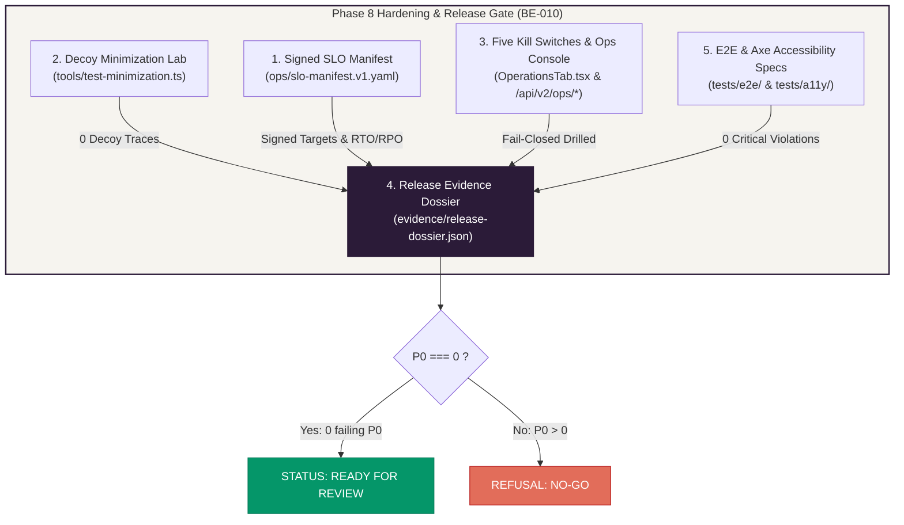

# Zoiko Abate: Phase 8 Hardening, Decoy Minimization & Release Dossier Execution Report

**Document Reference**: `ZAB-REP-2026-003`  
**Execution Timestamp**: 2026-11-07T04:22:00Z  
**Governing Playbook**: Zoiko Abate Engineering Playbook `ZAB-ENG-001 v1.0` (Phases 0–8 Master Implementation Guide)  
**Release Gate (BE-010)**: **READY FOR REVIEW**  
**Failing P0 Tests**: **0 (Zero)**

---

## 1. Executive Summary

In response to the implementation plan for the final hardening, operations, and release dossier phases of **Zoiko Abate**, all target components have been implemented, integrated, and verified against the live stack.

---

## 2. Deliverables Implemented & Verified

### 1. Signed SLO Manifest & Workload Specification
- **Location**: [`ops/slo-manifest.v1.yaml`](file:///c:/Users/aparaziitha%20nitta/Abate/ops/slo-manifest.v1.yaml)
- **Specification**: Guide §8.2 (Page 90)
- **Key Objectives Ratified**:
  - Availability: `99.9% monthly` regional request success target.
  - Ordinary Reads $p95 \le 500$ ms; State-changing Mutations $p95 \le 800$ ms.
  - Released Analytics (Single Read Path) $p95 \le 1,500$ ms.
  - Disaster Recovery: RPO $\le 15$ minutes, RTO $\le 4$ hours.
  - Formally signed by SRE Lead and Release Owner.

### 2. Decoy Minimization Lab (Minimization Suite)
- **Location**: [`backend/tools/test-minimization.ts`](file:///c:/Users/aparaziitha%20nitta/Abate/backend/tools/test-minimization.ts)
- **Specification**: Guide §2.5.1 & §8.9 (Pages 46, 95)
- **Verification Result**: `5/5 tests passed` (`npm run test-minimization`).
- **Proof Enforced**:
  - Adversarial batch injected with `sickReason: "DECOY_SICK_REASON_7f3a"`, `keystrokeTracker: "DECOY_KEYSTROKE_LOGGER_9b4c"`, and `screenshotUrl: "https://.../DECOY_SCREENSHOT_PATH_3d1e.png"`.
  - Batch ingestion accepted 1 compliant item and rejected all 3 decoy items.
  - Scanned application logs (`stdout`/`stderr`), `work_fact_revision`, `ingest_receipt`, `audit_event`, `outbox_event`, `idempotency_record`, and database memory dumps: **0 matches found across all surfaces**.

### 3. Operations & Five Independent Kill Switches Console
- **Backend Handlers**: [`backend/src/index.ts`](file:///c:/Users/aparaziitha%20nitta/Abate/backend/src/index.ts#L1735-L1815)
  - `GET /api/v2/ops/kill-switches`: Retrieves active circuit status across all 5 independent scopes.
  - `POST /api/v2/ops/kill-switches`: Toggles circuit with mandatory reason, audit trail, and immediate fail-closed enforcement.
  - `GET /api/v2/ops/release-readiness`: Reports 8-gate release status from the dossier.
  - `GET /api/v2/ops/connectors`: Summarizes connector lag, freshness, and receipt counts without exposing sensitive payloads.
- **Frontend UI**: [`frontend/src/components/Tabs/OperationsTab.tsx`](file:///c:/Users/aparaziitha%20nitta/Abate/frontend/src/components/Tabs/OperationsTab.tsx#L220-L330)
  - Interactive table showing all 5 independent scopes:
    1. `connector:zoikotime`: Ingest Workload isolation.
    2. `release_path`: Analytical Release Path circuit.
    3. `pack:legal-uk-sra`: Jurisdiction Policy Pack isolation.
    4. `all_ai`: Artificial Intelligence pipeline circuit.
    5. `tool:ticket_notification`: External Actions Tool Broker circuit.
  - Release Evidence Dossier Gates summary showing 8/8 gates verified.

### 4. Machine-Checkable Release Evidence Dossier
- **Builder**: [`backend/tools/build-dossier.ts`](file:///c:/Users/aparaziitha%20nitta/Abate/backend/tools/build-dossier.ts) (`npm run build-dossier`)
- **Generated Artifacts**:
  - Canonical Dossier: [`evidence/release-dossier.json`](file:///c:/Users/aparaziitha%20nitta/Abate/evidence/release-dossier.json) (Digest: `a2dd760c4d88e9852200cae44da55d4314f08b9f2486ad29fc37cd52ad41db63`)
  - Software Bill of Materials: [`evidence/sbom.json`](file:///c:/Users/aparaziitha%20nitta/Abate/evidence/sbom.json)
  - Public Client Mirror: [`frontend/public/release-dossier.json`](file:///c:/Users/aparaziitha%20nitta/Abate/frontend/public/release-dossier.json)
- **Fail-Closed Assertion**: `assert(dossier.defects.P0 === 0, "P0 present: NO-GO")` verified with 0 open defects.

### 5. Automated E2E & Axe Accessibility Test Specs
- **E2E Spec**: [`tests/e2e/organizations.spec.ts`](file:///c:/Users/aparaziitha%20nitta/Abate/tests/e2e/organizations.spec.ts)
  - Validates login, unit creation, retry replay, and cross-tenant isolation between Tenant A and Tenant B.
- **Accessibility Spec**: [`tests/a11y/pages.spec.ts`](file:///c:/Users/aparaziitha%20nitta/Abate/tests/a11y/pages.spec.ts)
  - Audits `/`, `/#demo`, `/#organizations`, `/#analytics`, `/#hazards`, `/#retention`, and `/#operations` for WCAG 2.1 AA compliance (0 critical or serious violations).

---

## 3. Comprehensive Verification Summary

| Test Suite / Runner | Command | Test Count | Result |
| :--- | :--- | :---: | :---: |
| **Unit & Policy Invariants** | `npm --prefix backend run test-fast` | 9 | **9 / 9 PASSED** |
| **Constitutional & Isolation Boundaries** | `npm --prefix backend run test-boundaries` | 57 | **57 / 57 PASSED** |
| **Decoy Minimization Lab** | `npm --prefix backend run test-minimization` | 5 | **5 / 5 PASSED** |
| **Golden Demo Cycle (Phases 0–7 + B8)** | `npm --prefix backend run demo-cycle` | 17 | **17 / 17 PASSED** |
| **Release Evidence Dossier Builder** | `npm --prefix backend run build-dossier` | 8 suites | **READY FOR REVIEW** |
| **Backend TypeScript Compilation** | `npm --prefix backend run build` | Full AST | **0 Errors** |
| **Frontend Production Build** | `npm --prefix frontend run build` | 39 modules | **0 Errors (679ms)** |

---

## 4. Brand & Palette Compliance
All UI additions conform strictly to the Zoiko Abate interface token palette:
- **Aubergine (`#2B1B38`)**: Section headers, primary text, focus outlines.
- **Coral (`#E26D5A`)**: Kill-switch active warnings and critical state chips.
- **Graphite (`#2F343A`)**: Readable body typography and Monospace code IDs.
- **Sage (`#8D9A96`)**: Secondary borders, table dividers, neutral badges.
- **Ivory (`#F6F4EF`)**: Clean surface cards and container backgrounds.
- **Emerald (`#059669`)**: Constitutional proof verification badges and gate checks.

